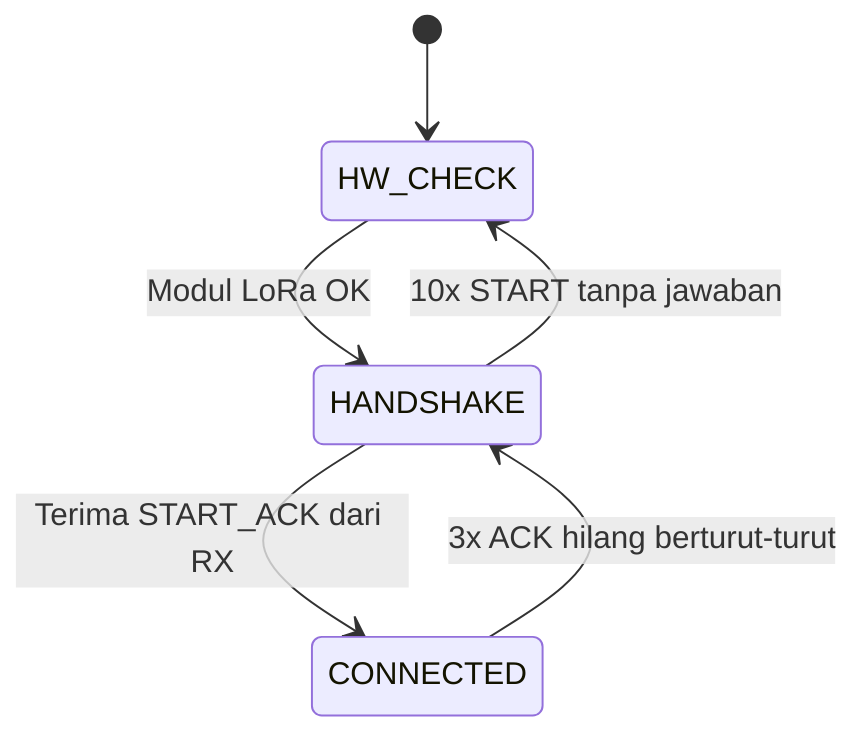

# EEPISAT GPS Telemetry — TX Node

Firmware ESP32 yang membaca posisi dari modul GPS **u-blox SAM-M10Q**, mengirimkannya lewat **LoRa E220-900T22D** ke node penerima (RX), lalu menampilkan status GPS dan kondisi link LoRa pada **dashboard web** melalui WiFi Access Point milik ESP32 sendiri.

Node ini tidak hanya mengirim data. Ia juga menjaga link dengan **handshake**, **ACK per paket**, dan **deteksi link putus otomatis**, sehingga cocok dipakai untuk pengujian jarak dan kualitas link LoRa.

---

## Daftar Fitur

| # | Fitur | Keterangan |
|---|-------|------------|
| 1 | Pembacaan GPS | Parsing NMEA dengan TinyGPSPlus: lat, lon, altitude, kecepatan, jumlah satelit, HDOP, arah, tanggal dan waktu UTC |
| 2 | Pengiriman data via LoRa | Paket biner ber-frame (`protocol.h`), dikirim setiap 2 detik dalam mode Transparent |
| 3 | Cek hardware LoRa otomatis | Cek pin AUX, masuk config mode (M0/M1), baca 8 register E220, lalu validasi baud rate |
| 4 | Handshake dengan RX | TX mengirim `START`, data baru dikirim setelah RX menjawab `START_ACK` |
| 5 | ACK / feedback per paket | Setiap paket GPS punya nomor urut (`seq`) dan harus dibalas `GPS_ACK` dengan `seq` yang sama |
| 6 | Deteksi link putus | 3 ACK hilang berturut-turut → kembali ke handshake. 10 handshake gagal → cek hardware ulang |
| 7 | Statistik link | Paket terkirim, ACK diterima, ACK hilang, packet loss, RTT, jumlah paket yang diterima RX |
| 8 | WiFi Access Point | ESP32 membuat WiFi `Lora Testing`, tanpa perlu router atau internet |
| 9 | Dashboard web | Halaman responsif (mendukung dark mode) yang diperbarui tiap 1 detik, plus tombol buka Google Maps |
| 10 | Endpoint JSON | `/data` mengembalikan seluruh status dalam JSON untuk dipakai aplikasi lain |
| 11 | LED indikator | Berkedip saat cek hardware atau handshake, menyala terus saat terhubung |
| 12 | Non-blocking | Semua proses tunggu memanggil `background()`, jadi GPS, web server, dan LED tetap berjalan |
| 13 | Log Serial | Log lengkap (`[HW]`, `[TX]`, `[LoRa]`, `[GPS]`) pada 115200 baud |

---

## Perangkat Keras

- ESP32 (DevKit)
- GPS **u-blox SAM-M10Q**
- LoRa **EBYTE E220-900T22D**
- LED indikator (+ resistor)
- Antena LoRa dan antena GPS

### Konfigurasi Pin

| Fungsi | Pin ESP32 | Keterangan |
|--------|-----------|------------|
| GPS RX | `17` | Terhubung ke pin TX modul GPS (UART2) |
| GPS TX | `16` | Terhubung ke pin RX modul GPS (UART2) |
| LoRa RX | `26` | Terhubung ke pin TXD E220 (UART1) |
| LoRa TX | `25` | Terhubung ke pin RXD E220 (UART1) |
| LoRa M0 | `32` | Mode control |
| LoRa M1 | `33` | Mode control |
| LoRa AUX | `25` ⚠️ | Status modul (input). **Lihat catatan di bawah** |
| LED | `23` | Indikator status |

| Parameter | Nilai |
|-----------|-------|
| `GPS_BAUD` | 115200 |
| `LORA_BAUD` | 9600 (harus sama dengan baud UART di modul E220) |

> ⚠️ **Konflik pin:** pada kode saat ini `LORA_TX` dan `LORA_AUX` sama-sama memakai **GPIO 25**. Satu pin tidak bisa menjalankan dua fungsi sekaligus. Ubah salah satunya ke GPIO lain yang bebas (misalnya `LORA_AUX` ke `27` atau `34`) dan sesuaikan wiring.

---

## Cara Kerja

### Alur State



| State | Yang dilakukan | LED |
|-------|----------------|-----|
| `HW_CHECK` | Cek modul LoRa. Kalau gagal, diulang setiap 3 detik | Berkedip |
| `HANDSHAKE` | Mengirim paket `START` setiap 2 detik, menunggu `START_ACK` | Berkedip |
| `CONNECTED` | Mengirim paket GPS setiap 2 detik dan menunggu `GPS_ACK` | Menyala terus |

### 1. Cek Hardware LoRa

Dijalankan saat boot dan setiap kali link tidak pulih:

1. Masuk **mode normal** (M0=0, M1=0), lalu pastikan pin **AUX = HIGH**. Kalau tidak, pesan error: *"AUX tidak HIGH (cek power dan wiring AUX)"*.
2. Masuk **config mode** (M0=1, M1=1), lalu kirim perintah baca register `C1 00 08`.
3. Kalau modul tidak menjawab, pesan error: *"Modul tidak menjawab config"*.
4. Cetak konfigurasi modul ke Serial: address, channel (+ frekuensi MHz), baud UART, air rate, mode TX (Transparent atau Fixed), dan status RSSI byte.
5. Bandingkan baud UART modul dengan `LORA_BAUD`. Kalau beda, cek hardware dianggap gagal.
6. Kembali ke mode normal.

Pesan error cek hardware ikut tampil di dashboard saat state `HW_CHECK`.

### 2. Handshake

TX mengirim paket `START` (biner) setiap `HANDSHAKE_INTERVAL` (2 detik). Begitu RX membalas `START_ACK`, state berpindah ke `CONNECTED` dan paket GPS pertama langsung dikirim.

### 3. Kirim Data dan Feedback

Setiap 2 detik TX mengirim satu paket GPS dengan `seq` yang bertambah. Isi payload (`GpsPayload`):

| Field | Satuan | Keterangan |
|-------|--------|------------|
| `lat_e6` | derajat × 10⁶ | Latitude (0 jika belum fix) |
| `lon_e6` | derajat × 10⁶ | Longitude (0 jika belum fix) |
| `alt_cm` | cm | Ketinggian |
| `speed_x100` | km/h × 100 | Kecepatan (dibatasi 0–65535) |
| `sats` | jumlah | Satelit yang terpakai |
| `flags` | bit | bit0 = 1 jika GPS fix |

Paket tetap dikirim walaupun GPS belum fix (`flags` = 0), supaya kondisi link LoRa bisa dites tanpa harus menunggu sinyal satelit.

Setelah mengirim, TX menunggu `GPS_ACK` dengan `seq` yang cocok:

- **ACK datang** → `pktAcked++`, `missedAcks` direset, RTT dihitung, dan jumlah paket yang sudah diterima RX (`remoteRxCount`) dibaca dari payload ACK.
- **ACK tidak datang dalam 1,5 detik** (`ACK_TIMEOUT`) → `pktLost++` dan `missedAcks++`.
- **`missedAcks` mencapai 3** (`MAX_MISSED_ACK`) → link dianggap putus, kembali ke handshake.

### 4. Pengaturan Timing

| Konstanta | Nilai | Fungsi |
|-----------|-------|--------|
| `TX_INTERVAL` | 2000 ms | Jeda kirim paket GPS |
| `ACK_TIMEOUT` | 1500 ms | Batas tunggu ACK |
| `MAX_MISSED_ACK` | 3 | ACK hilang berturut-turut sebelum link putus |
| `HANDSHAKE_INTERVAL` | 2000 ms | Jeda kirim `START` |
| `HS_TRIES_BEFORE_HW` | 10 | Gagal handshake sekian kali → cek hardware ulang |
| `HW_RETRY_INTERVAL` | 3000 ms | Jeda ulang cek hardware |
| `LED_BLINK_MS` | 250 ms | Kecepatan kedip LED |

---

## Dashboard Web

1. Sambungkan HP atau laptop ke WiFi **`Lora Testing`** (terbuka, tanpa password).
2. Buka **`http://192.168.4.1`** (alamat tepatnya dicetak di Serial Monitor saat boot).

Isi dashboard:

- **Status LoRa**: `TERHUBUNG` (hijau), `MENUNGGU RX` (kuning), `MODUL ERROR` (merah, disertai pesan penyebabnya)
- **Status GPS**: `FIX` (hijau), `MENCARI SATELIT` (kuning), `TIDAK ADA DATA` (merah, tidak ada karakter NMEA masuk)
- **Posisi**: latitude, longitude, altitude, kecepatan, satelit, HDOP, arah, waktu UTC
- **Link LoRa**: paket terkirim, ACK diterima, ACK hilang, packet loss (%), RTT, waktu ACK terakhir, jumlah paket diterima RX, missed ACK, jumlah client AP
- **Tombol Google Maps** (muncul saat GPS fix, peta butuh internet di HP)
- **Banner error** otomatis muncul kalau koneksi ke ESP32 terputus, dan dashboard mencoba lagi sendiri

Halaman disimpan di flash (`PROGMEM`), tampilan menyesuaikan mode terang atau gelap perangkat.

### Endpoint

| Endpoint | Keterangan |
|----------|------------|
| `GET /` | Halaman dashboard |
| `GET /data` | Data status dalam JSON (`Cache-Control: no-store`) |

Contoh respons `/data`:

```json
{
  "state": "CONNECTED",
  "hw": "OK",
  "chars": 48213,
  "fix": true,
  "lat": -7.275678,
  "lon": 112.793210,
  "alt": 12.40,
  "spd": 0.35,
  "sats": 9,
  "hdop": 1.12,
  "crs": 182.3,
  "time": "03:41:22",
  "date": "2026-11-09",
  "sent": 120,
  "acked": 118,
  "lost": 2,
  "rtt": 410,
  "ackago": 820,
  "rxc": 118,
  "miss": 0,
  "maxmiss": 3,
  "sta": 1,
  "up": 245
}
```

Nilai yang belum valid (misalnya `lat`, `lon` sebelum fix) dikirim sebagai `null`.

| Field | Arti |
|-------|------|
| `state` | `HW_CHECK`, `HANDSHAKE`, atau `CONNECTED` |
| `hw` | Hasil terakhir cek hardware |
| `chars` | Total karakter NMEA yang sudah diproses (0 berarti GPS tidak mengirim data) |
| `fix` | `true` jika posisi GPS valid |
| `lat`, `lon`, `alt`, `spd`, `sats`, `hdop`, `crs` | Data GPS |
| `time`, `date` | Waktu dan tanggal UTC dari GPS |
| `sent`, `acked`, `lost` | Counter paket |
| `rtt` | Round-trip time paket terakhir (ms) |
| `ackago` | Selisih waktu sejak ACK terakhir (ms), `-1` jika belum pernah |
| `rxc` | Jumlah paket yang sudah diterima RX (dilaporkan RX lewat ACK) |
| `miss`, `maxmiss` | ACK hilang berturut-turut dan batasnya |
| `sta` | Jumlah client yang tersambung ke AP |
| `up` | Uptime (detik) |

---

## Contoh Log Serial

```
================================
EEPISAT GPS TELEMETRY
================================
AP  : Lora Testing
Web : http://192.168.4.1
Memulai cek modul LoRa...
[HW] Cek modul LoRa...
[HW] Config modul LoRa:
     Address   : 0x0000
     Channel   : 23 (873.125 MHz)
     UART      : 9600 bps
     Air rate  : 2.4 kbps
     Mode TX   : Transparent
     RSSI byte : OFF
[HW] Modul LoRa OK -> handshake dengan RX
[LoRa] kirim START (1/10), menunggu RX...
[LoRa] RX menjawab START -> TERHUBUNG
[TX] #2 fix=1 lat=-7.275678 lon=112.793210 alt=12.40 spd=0.35 sat=9
[LoRa] ACK #2 OK  RTT=410 ms  RX_count=1
[LoRa] ACK #3 TIMEOUT (1/3)
[LoRa] LINK PUTUS -> ulang handshake
```

---

## Instalasi

### Library

- **TinyGPSPlus** (Mikal Hart)
- `WiFi` dan `WebServer` sudah termasuk di Arduino core ESP32
- File **`protocol.h`** harus berada di folder yang sama dengan sketch. File ini mendefinisikan `FrameParser`, `protoBuild()`, `GpsPayload`, `START_WORD`, `PROTO_MAX_PAYLOAD`, dan tipe paket `PKT_START`, `PKT_START_ACK`, `PKT_GPS`, `PKT_GPS_ACK`. **File yang sama harus dipakai oleh node RX.**

### Arduino IDE

1. Pasang *ESP32 board package* lewat Boards Manager.
2. Pasang library **TinyGPSPlus** lewat Library Manager.
3. Pilih board ESP32 yang dipakai, lalu upload.
4. Buka Serial Monitor pada **115200 baud**.

### PlatformIO (opsional)

```ini
[env:esp32dev]
platform = espressif32
board = esp32dev
framework = arduino
monitor_speed = 115200
lib_deps =
    mikalhart/TinyGPSPlus
```

---

## Konfigurasi Modul E220

Pengaturan di TX dan RX harus sama:

| Parameter | Nilai |
|-----------|-------|
| Mode transmisi | **Transparent** (bukan Fixed) |
| UART | 9600 bps, 8N1 (sama dengan `LORA_BAUD`) |
| Address, Channel, Air rate | Harus sama di TX dan RX |

Kalau modul masih dalam mode **Fixed**, firmware hanya mencetak peringatan di Serial. Paket tidak akan sampai karena `sendFrame()` tidak menambahkan alamat tujuan.

---

## Catatan

- **Konflik pin 25**: lihat peringatan di bagian [Konfigurasi Pin](#konfigurasi-pin).
- **Baud GPS**: `GPS_BAUD` (115200) harus sama dengan baud yang sudah diset pada modul SAM-M10Q.
- **WiFi AP terbuka**: `AP_PASSWORD` dikosongkan sehingga siapa pun bisa terhubung. Isi minimal 8 karakter kalau ingin memakai password.
- **Node RX**: repo ini hanya berisi sisi TX. Node RX harus membalas `PKT_START` dengan `PKT_START_ACK`, dan membalas `PKT_GPS` dengan `PKT_GPS_ACK` yang membawa `seq` yang sama. Payload ACK berisi jumlah paket yang sudah diterima RX (little-endian pada byte ke-1 dan ke-2).
- **Struktur frame** (header, checksum, dan sebagainya) ditentukan sepenuhnya oleh `protocol.h`.

---

## Struktur Proyek

```
.
├── main.ino        # Firmware TX (kode ini)
├── protocol.h      # Definisi frame, parser, dan payload (dipakai TX dan RX)
└── README.md
```
